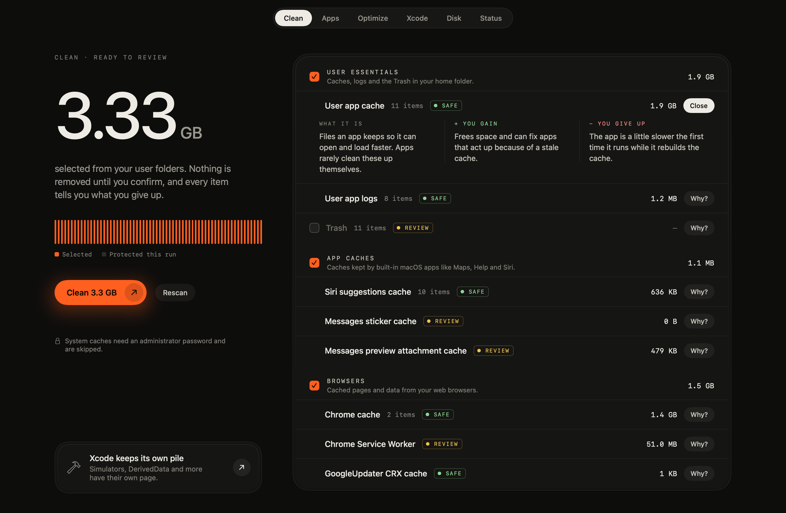
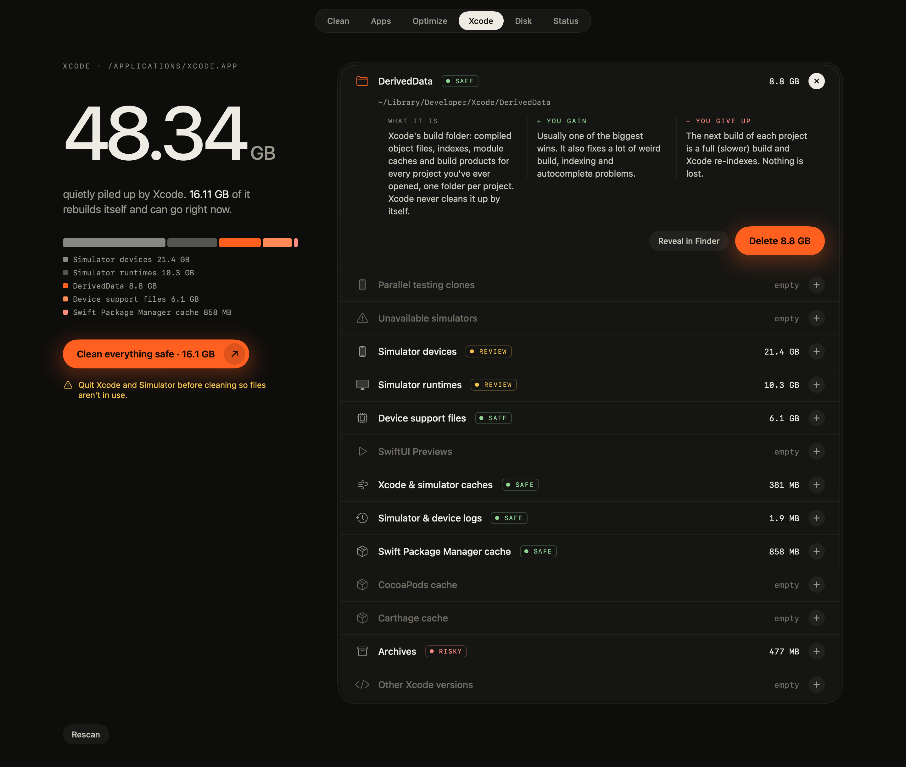
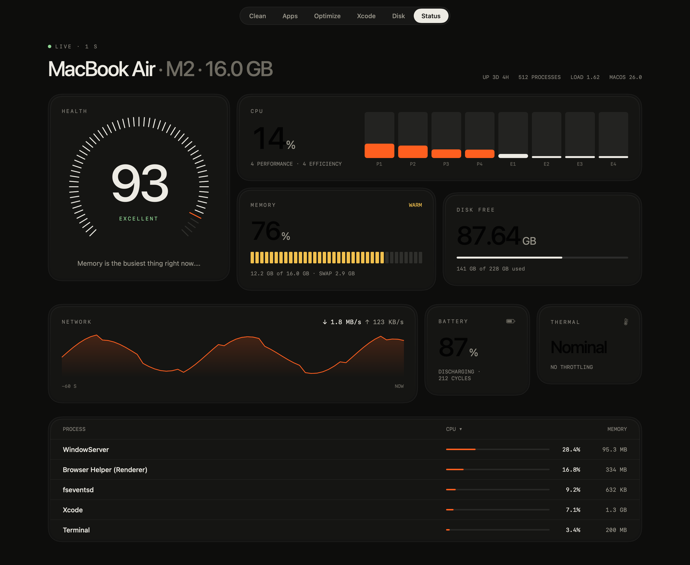
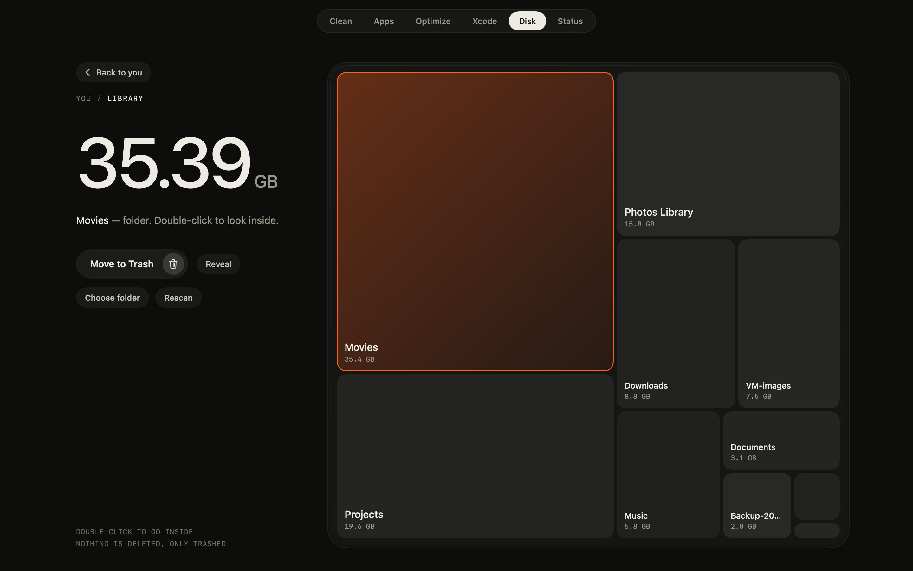
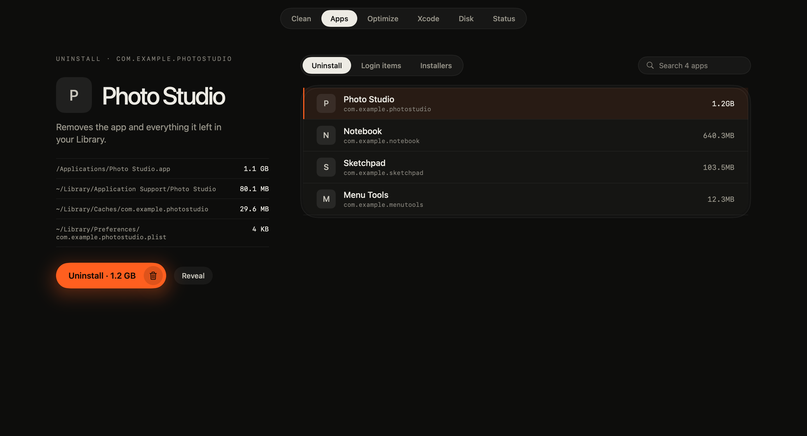
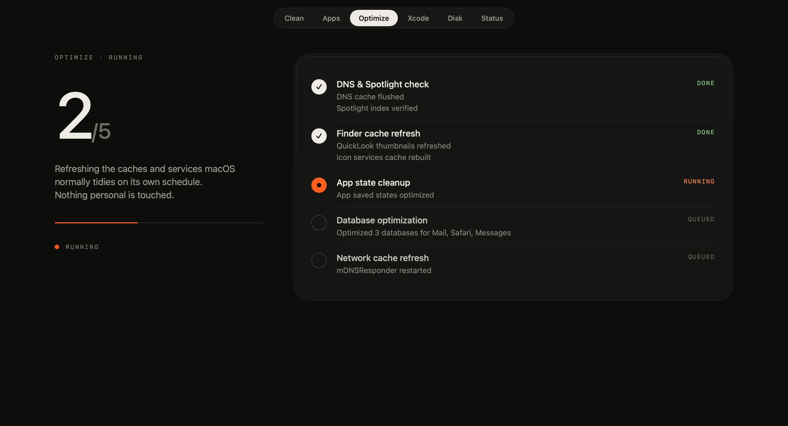
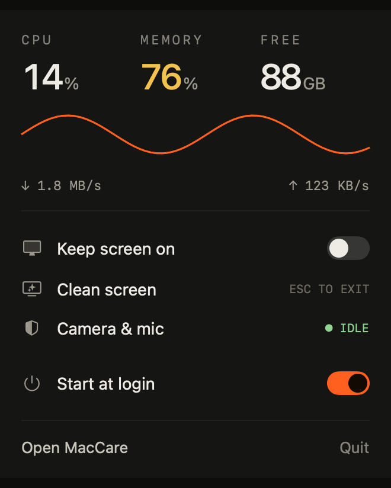

<p align="center">
  
</p>

<h1 align="center">MacCare</h1>

<p align="center">
  A calm, dark Mac cleaner that explains what it is about to delete.<br>
  Clean caches, uninstall apps, free Xcode's hidden gigabytes, see where your disk went, and watch your Mac's health from the menu bar.
</p>

<p align="center">
  <a href="https://github.com/hlum/MacCare/releases/latest"><b>Download the DMG</b></a> ·
  <a href="INSTALL.md">Install guide</a> ·
  macOS 14+ · Apple Silicon &amp; Intel
</p>

<p align="center">
  
</p>

> The screenshots in this README are rendered from MacCare's own SwiftUI views using **sample data**, not live captures of a real Mac.

## Why

Most cleaners say "free up 12 GB" and leave the rest to trust. MacCare shows **what each item is, what you gain,
and what you give up** before anything is removed, and nothing is deleted until you confirm.

Every item carries a tag: **SAFE** (rebuilds itself), **REVIEW** (you lose data or must re-download something big),
or **RISKY** (can't be recreated).

## What's inside

| | |
|---|---|
| **Clean** | Scans caches, logs and leftovers with a dry run. Pick groups, read the *Why?*, then clean. The Trash is opt-in. |
| **Xcode** | 14 kinds of Xcode clutter (DerivedData, simulators, runtimes, device support, archives, old Xcodes…), each explained, with pickers for simulators, runtimes and archives. |
| **Disk** | A treemap of any folder. Click to select, double-click to go inside, **Back** to return. Files go to the Trash. |
| **Apps** | Uninstall an app together with its leftovers, see login items, and clear old installers. |
| **Optimize** | Refresh DNS, Spotlight, Finder and other caches, step by step. |
| **Status** | Live health score, CPU per core, memory, disk, network, battery and top processes. |
| **Menu bar** | CPU and memory at a glance, **Keep screen on**, **Clean screen**, a camera/mic check, and **Start at login**. |

<table>
  <tr>
    <td></td>
    <td></td>
  </tr>
  <tr>
    <td></td>
    <td></td>
  </tr>
  <tr>
    <td></td>
    <td align="center"></td>
  </tr>
</table>

## Install

1. `brew install mole` (the engine, see below)
2. Download the DMG from the [latest release](https://github.com/hlum/MacCare/releases/latest) and drag MacCare to Applications.
3. First launch: the app isn't notarized, so approve it once in **System Settings › Privacy & Security › Open Anyway**.

Full steps, troubleshooting and uninstall: **[INSTALL.md](INSTALL.md)**.

## How it works

MacCare is a native SwiftUI app. The scanning and cleaning for Clean, Optimize, Apps and Status is done by the
open-source [`mo`](https://github.com/tw93/Mole) command, which MacCare runs as a separate process and reads
(dry-run text and JSON). The Xcode page and the Disk page are MacCare's own code.

Safety model:

- Scans are dry runs. Deletion only happens after you confirm.
- Xcode-page deletions go through one gate (`DeleteGuard`) that only allows `~/Library/Developer`, `~/Library/Caches`,
  `~/Library/Logs` and whole `/Applications/Xcode*.app`. It refuses `..` paths, the folders themselves, CoreDevice
  (a mirror of a connected iPhone), the active Xcode, and anything on another volume. It has unit tests.
- `mo` can't clean one item at a time, so unchecking a group protects that group for one run through a marked,
  temporary block in `~/.config/mole/whitelist`. It is restored afterwards, and repaired on next launch if the app was killed mid-run.
- Disk and installer removals go to the Trash. Uninstalls are only enabled when `mo` matched exactly one app.

## Build from source

```sh
brew install xcodegen mole
git clone https://github.com/hlum/MacCare.git && cd MacCare
xcodegen generate
xcodebuild -project MacCare.xcodeproj -scheme MacCare -configuration Release -derivedDataPath build build
open build/Build/Products/Release/MacCare.app
xcodebuild -project MacCare.xcodeproj -scheme MacCare -derivedDataPath build test   # unit tests
```

Regenerate the README screenshots: `TEST_RUNNER_MACCARE_SHOTS=1 xcodebuild … test -only-testing:MacCareTests/ScreenshotTests`.
The icon is drawn by `swift Tools/make-icon.swift`. `Tools/make-dmg.sh` builds the DMG.

## Status and limits

- Tested against `mo` **1.56.1** on macOS 27 / Apple Silicon. The Intel slice is built but untested.
- Real `clean`, `optimize` and `uninstall` runs are lightly tested. Start with small items and read each preview.
- Not implemented: fan control, Wi-Fi low-latency mode, camera/mic notifications.
- The first release is ad-hoc signed and **not notarized**.

## Licence and credits

MacCare is [MIT licensed](LICENSE). It needs [`mo`](https://github.com/tw93/Mole) (GPL-3.0, by tw93), which is **not
bundled**; users install it themselves. MacCare is an independent project, not affiliated with tw93 or the paid
*Mole for Mac* app, and uses none of its assets. The Xcode page is ported from the author's own
[cleanX](https://github.com/hlum/cleanX). See [THIRD-PARTY-NOTICES.md](THIRD-PARTY-NOTICES.md).
